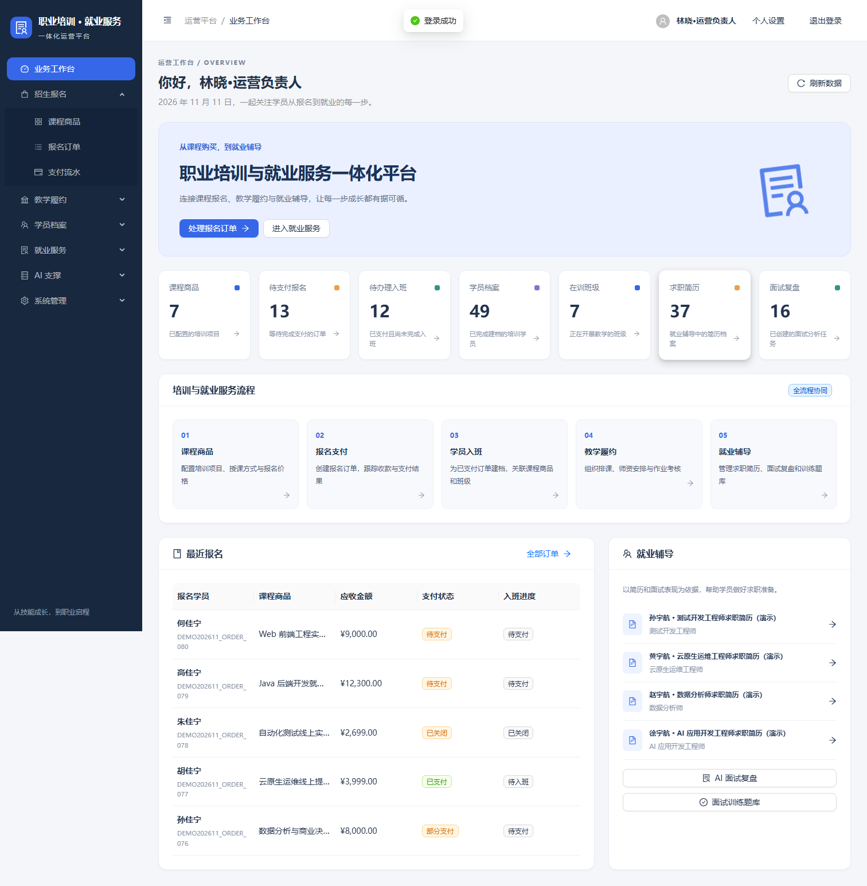
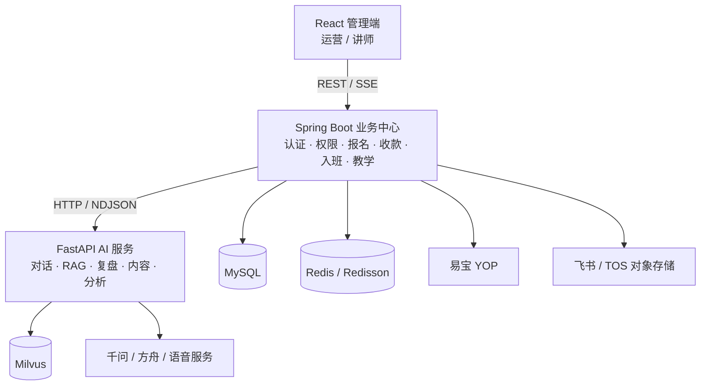
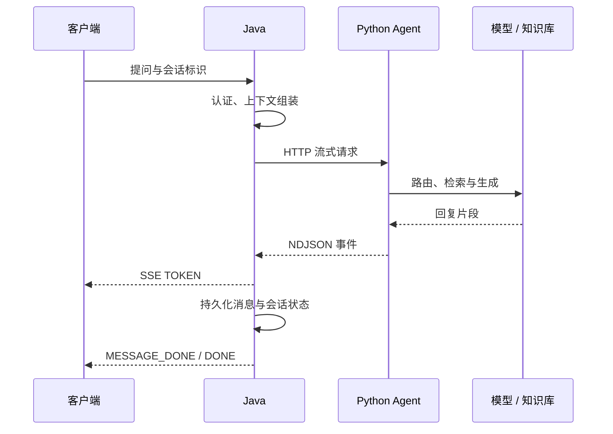
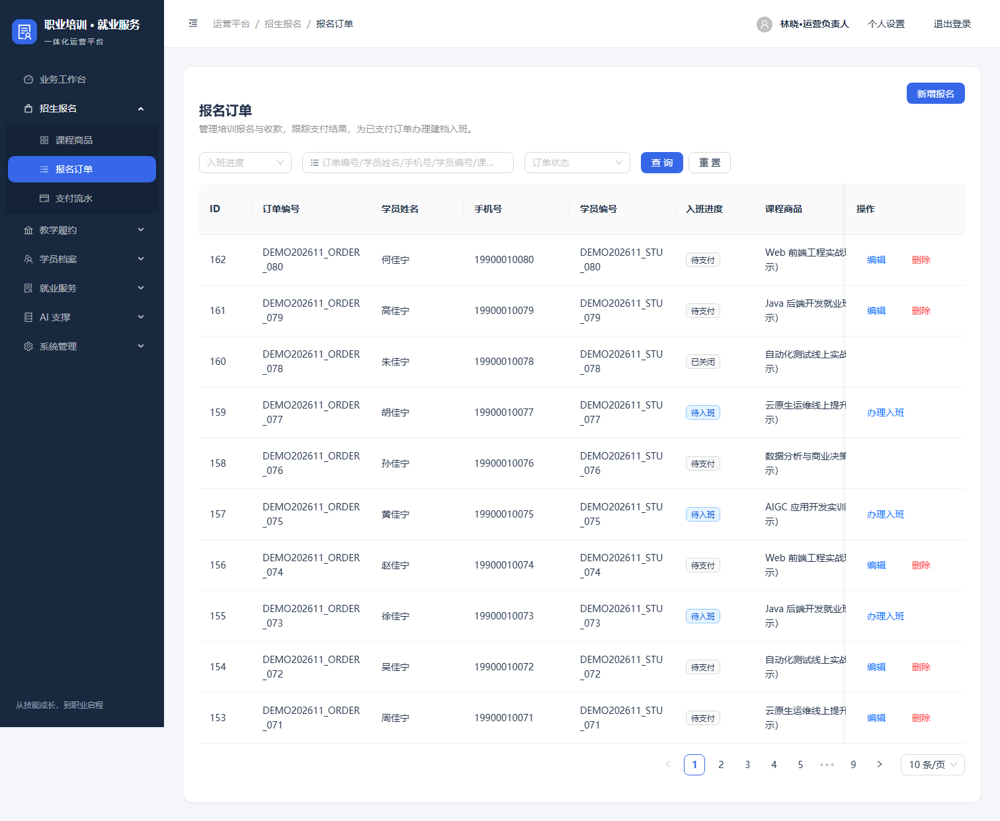
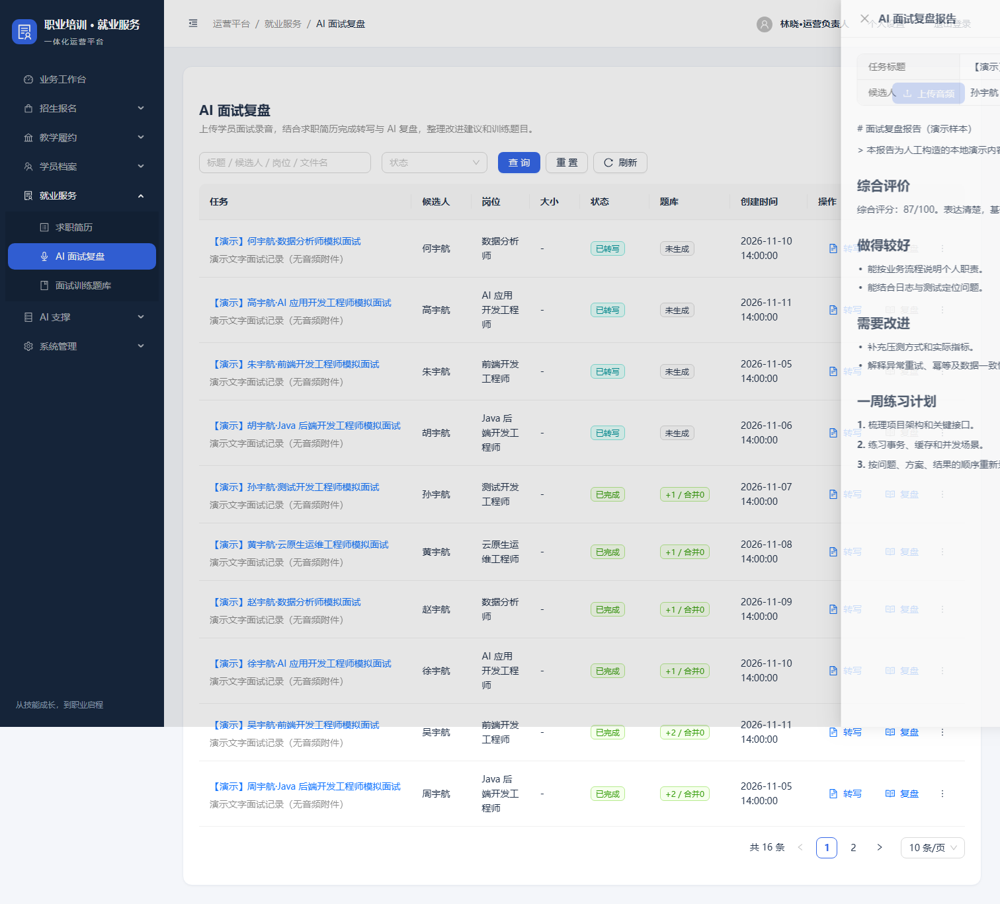
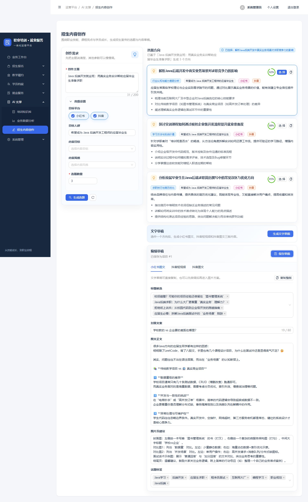
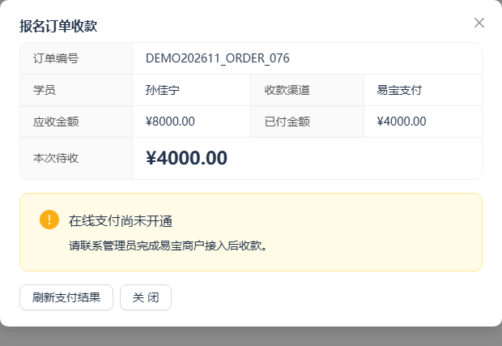

# CareerFlow AI · 职业培训与就业服务一体化平台

**从课程报名到就业辅导，让订单、教学与 AI 服务形成可追踪的业务闭环。**

基于 **Spring Boot 3 + MyBatis + Redis/Redisson + FastAPI + React** 的前后端分离项目。Java 负责业务规则、权限与数据一致性，Python 提供模型编排和知识检索能力，React 提供运营工作台。项目重点放在支付回调幂等、事务化入班和跨服务流式问答的工程实现。

[快速启动](docs/getting-started.md) · [支付接入说明](web/docs/payment-integration.md) · [Java 后端](admin) · [AI 服务](agent) · [管理端](web)



## 1. 项目介绍

面向提供技能培训与求职辅导的服务机构，覆盖运营、讲师与学员三类角色，解决报名收款、教学交付和就业辅导分散管理的问题。

- **运营侧**：维护课程商品、报名订单与支付流水，办理已付订单入班，跟踪教学和就业服务进度。
- **讲师侧**：查看班级与排课，管理作业、考核和学员资料。
- **学员能力层**：提供报名、入班、问答与模拟面试等后端 API；本仓库提供 React 管理端，未包含独立学员前端。
- **AI 支撑侧**：提供知识问答、面试复盘、运营内容生成、数据分析与日志诊断等能力。

业务场景统一为“职业培训与就业服务”，演示课程包括 Java 后端、Web 前端、AIGC 应用开发、数据分析等方向。

## 2. 核心业务闭环


| 业务域 | 已有能力 | 关键约束 |
| --- | --- | --- |
| 招生报名 | 商品、订单、应收/实收、入班进度 | 支付金额由服务端按订单余额计算 |
| 支付收款 | 易宝下单、收银台链接、通知处理、支付流水 | 验签及业务校验；重复成功通知仅记账一次 |
| 入班履约 | 学员建档、线上/线下模式、商品和班级绑定 | 校验已付清状态；订单行锁与事务控制重复提交 |
| 教学交付 | 校区、课程大纲、班级、课表、讲师安排、作业考核 | 与学员、班级及课程数据关联 |
| 就业辅导 | 简历档案、题库、面试复盘、模拟面试接口 | 语音、模型和存储能力按外部配置启用 |
| 平台支撑 | 用户/角色/权限、运行时配置、飞书登录、文件上传 | JWT、请求签名、权限拦截与预签名上传 |

## 3. 总体架构

采用 **Java 模块化单体 + 独立 Python AI 服务**。业务数据和模型调用分层，避免把提示词、向量检索和外部模型 SDK 耦合进业务事务。



### 技术栈

| 层次 | 技术 |
| --- | --- |
| Java 业务后端 | Java 17、Spring Boot 3.2、MyBatis、PageHelper、Bean Validation |
| 数据与并发控制 | MySQL、Redis、Redisson、数据库行锁、Spring 事务 |
| AI 服务 | Python 3.11、FastAPI、LangChain、LlamaIndex、Milvus、OpenAI 兼容接口 |
| 管理端 | React 18、TypeScript 5、Vite 5、Ant Design 5、Axios |
| 外部集成 | 易宝 YOP SDK、飞书开放平台、火山 TOS、语音服务 |
| 工程验证 | JUnit 5、Mockito、H2/MyBatis 集成测试、Pytest、Playwright 验证脚本、GitHub Actions |

## 4. Java 后端关键设计

### 4.1 报名收款与支付一致性

将报名订单与支付单分开建模，支持订单余额补缴。创建收银台时使用 Redisson 锁与订单行锁控制并发，同一有效收银台可复用，并保存渠道单号、链接与过期时间。

支付通知经过 **SDK 验签 → 商户/订单/金额校验 → 锁定订单与支付单 → 事务更新流水和实收金额**。同一支付单首次成功才累加实收金额，重复通知不会重复入账，晚到的失败通知不会覆盖成功。

渠道超时或收银台过期保留待确认记录，阻止直接重复下单；已发起支付的报名订单限制编辑与删除。公开付款返回页只查询支付状态，支付结果以可靠通知为依据。

- [收银台服务](admin/src/main/java/cn/yq/modules/payment/service/OrderCheckoutService.java)
- [回调事务处理](admin/src/main/java/cn/yq/integration/yeepay/callback/service/impl/YeepayPaymentCallbackTxServiceImpl.java)
- [支付集成测试](admin/src/test/java/cn/yq/modules/payment/CheckoutIntegrationTest.java)

> 支付入口和渠道适配代码已完成；当前无易宝商户配置，尚未验证真实下单、扣款和公网回调。演示支付流水使用 LOCAL_DEMO / LOCAL_FIXTURE 标记。

### 4.2 已付订单的事务化入班

管理端与学员 API 复用同一个入班服务。办理前校验已付清、报名手机号和班级一致性，使用订单行锁串行化同一订单的重复请求。学员建档、商品关联和线下班级绑定放在同一事务中；已有一致档案时返回原记录。

- [入班服务](admin/src/main/java/cn/yq/modules/sales/service/OrderEnrollmentService.java)
- [入班规则测试](admin/src/test/java/cn/yq/modules/sales/service/OrderEnrollmentServiceTest.java)

### 4.3 跨服务流式问答与会话持久化

Java 管理学员身份、会话和消息数据，Python 处理上下文、检索与模型调用。Python 以 NDJSON 返回事件，Java 转换为 SSE，前端可增量接收回复。



历史消息通过摘要压缩控制上下文规模；知识问答按问题类型选择检索路径。取消、异常和消息完成由事件协议区分，便于客户端恢复交互状态。

- [Java 流式问答实现](admin/src/main/java/cn/yq/modules/studentportal/biz/impl/StudentPortalAiChatBizImpl.java)
- [Python 问答服务](agent/app/services/student_chat/student_chat_service.py)

### 4.4 认证、权限与文件访问

后台采用 JWT、RBAC 和带时间戳/nonce 的 HMAC 请求签名，结合菜单、按钮和接口权限管理。学员 API 使用独立的身份与资源范围校验。文件通过 TOS 预签名 URL 上传，云端凭据保留在服务端配置中。

## 5. AI 应用能力

| 能力 | 实现方式 | 当前验证范围 |
| --- | --- | --- |
| 知识问答 | 问题路由、历史摘要、向量召回、rerank、流式生成 | 已验证真实模型 SSE 与消息持久化；Milvus 全链路待验证 |
| 知识入库 | 文档解析、分块、embedding、入库状态 | 资料、代码、Schema 和指标使用不同 collection |
| 面试辅导 | 简历、题库、录音识别、复盘报告、实时面试接口 | 演示复盘为构造数据；真实语音链路依赖外部配置 |
| 运营内容 | AI 选题与文案草稿、可选图片生成 | 选题与文本草稿已有真实模型联调记录 |
| 数据分析 | Schema/指标检索、SQL 生成、规则校验、结果解读 | 有 SQL 防护等单元测试；规则校验仍需配合只读数据库权限 |
| 日志诊断 | 日志上下文、代码知识检索、模型分析 | 需配置云日志与模型服务后验证 |

源码入口：[Milvus 封装](agent/app/services/knowledge_base/milvus_service.py) · [SQL 规则校验](agent/app/services/data_analysis/sql_guard.py)

## 6. 界面展示

报名订单连接实收金额、支付流水与入班进度：



<details>
<summary>查看更多：面试复盘、运营内容与收款入口</summary>

面试复盘展示结构化报告；图中报告使用演示数据。



运营内容工作台：



订单收款入口；未配置商户时显示未开通状态：



</details>

截图来自本地联调环境，统计数量可能包含额外测试记录，不作为生产规模或性能指标。

## 7. 目录与启动

```text
CareerFlow-AI-Platform/
├── admin/                  # Java 业务中心、SQL 和测试
├── web/                    # React 管理端、支付联调脚本
├── agent/                  # FastAPI、模型编排与知识检索
├── docs/                   # 启动说明与演示截图
├── compose.yaml            # 本地 MySQL / Redis
└── .github/workflows/      # Java / Python / Web 检查
```

环境要求：JDK 17+、Maven 3.9+、Node.js 20+、Python 3.11、uv、MySQL 8 和 Redis。完整步骤见 **[本地启动指南](docs/getting-started.md)**。

完成依赖安装和数据库初始化后，分别运行：

```bash
# 终端一：AI 服务
cd agent
uv run uvicorn app.main:app --host 127.0.0.1 --port 9000

# 终端二：Java 服务
cd admin
mvn spring-boot:run -Dspring-boot.run.profiles=local

# 终端三：管理端
cd web
npm run dev -- --host 127.0.0.1
```

- 管理端：<http://127.0.0.1:5173>
- Java OpenAPI：<http://127.0.0.1:8081/yq-admin/swagger-ui/index.html>
- Python OpenAPI：<http://127.0.0.1:9000/docs>

初始化管理员为 `admin / password`；可选演示数据提供 `demo_ops / Demo123456`。以上仅供本地开发。

## 8. 验证与演示数据

当前版本验证结果：

- **Java：38 项测试通过**，覆盖收款契约、回调校验、重复/乱序通知、并发、H2/MyBatis 事务回滚、入班规则与权限。
- **Python：49 passed，1 skipped**；默认跳过需要显式开启的模型延迟实验。
- **Web：TypeScript 检查与 Vite 生产构建通过**。
- 已有 14 项支付浏览器/API 检查记录；其中 2 项采用拦截响应验证 UI 契约，不代表真实渠道交易。

```bash
# 在对应模块目录运行
mvn test
uv run --extra dev pytest -q
npm ci && npm run build
```

演示脚本可生成 80 条报名订单、68 条支付样本、48 名学员、8 个班级，以及课表、作业、简历、题库和复盘记录。脚本固定使用独立本地库，写入前备份；不会调用支付、模型、短信或云存储服务。

## 9. 当前边界与演进

本项目用于工程实践与面试展示。真实支付、飞书、云存储、语音与 RAG 外部服务需配置并逐项验收；渠道主动查单、关单、退款和自动对账尚待补充。

现有密码仍为开发阶段明文存储，接口权限主要按路径匹配。生产使用前需完成密码哈希迁移、HTTP 方法维度授权、服务间鉴权及配置加密等改造。AI 长任务目前依赖本地线程池，持久化任务恢复和跨进程调度是后续演进方向。

工程保留了 RocketMQ、XXL-Job 的依赖声明，当前业务未落地消息消费或分布式调度；此处不将依赖等同于已实现能力。

## 10. 工程来源

项目基于现有 YQ-AI 前端、Java 后端与 Python Agent 工程进行业务整合和改造，保留部分模块名、包名与数据库表前缀。本文沿用参考材料的“业务—架构—模块—AI—部署”组织方式，内容按当前职业培训与就业服务场景及源码实现重写。
